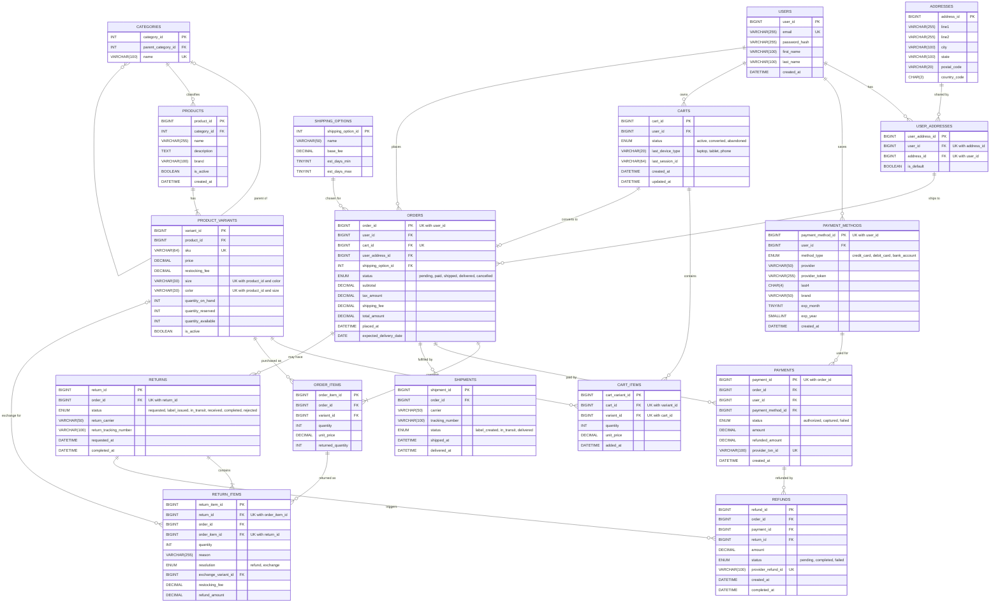

# Relational ERD — Draft 1

## Design notes

- **Data types**: every `DECIMAL` is `DECIMAL(12,2)`. `quantity_available` is a stored generated column (`quantity_on_hand - quantity_reserved`).
- **Products** hold common columns only. Category-specific attributes live in MongoDB, keyed by `product_id`. Every product has at least one variant, and `size` / `color` are `NOT NULL` with `''` meaning "not applicable".
- **Inventory** is per variant (`quantity_on_hand`, `quantity_reserved`).
- **Carts**: at most one `active` cart per user. Every order comes from exactly one cart.
- **Addresses**: many-to-many with users through `user_addresses`. `is_default` is per user.
- **Payments** store only a provider token, `last4`, `brand` and expiry. `refunds` is a separate ledger, one row per refund event.
- **Returns** are per order item (`return_items`). `return_items.order_id` is denormalized so composite FKs keep a return inside its own order.
